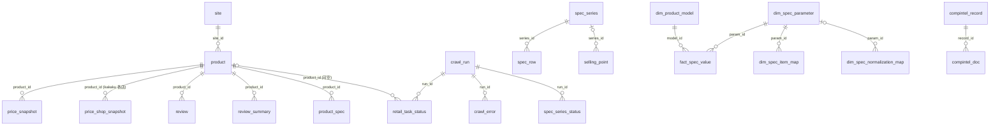

# 数据库交接专版（唯一主库 `data/overseas.db`）

> **本文是数据库设计与结构的自包含权威说明**，专为交接者写。读完这一份，即可完全理解数据库的设计意图、35 张表的结构与关系、各业务线的读写归属、最容易踩的坑、以及从零重建数据库的完整步骤。
>
> - **逐列明细**（类型/约束/索引/行数）见同目录 `数据库表结构明细.md`（由 `gen_db_doc.py` 从实库自动生成，与实库逐一吻合）。
> - **建表 DDL 真源**：`overseas/schema.sql`（27 张核心表）+ `规格表结构构建.sql`（3 张 dim/fact 表）+ `overseas/db.py`（5 张表迁移）。
> - 本文件是 `01_项目代码/docs/数据库结构说明.md` 的交接增强版（加了重建步骤、读写归属速查、DDL 来源表）。

---

## 一、数据库全景（交接者首先建立的概念）

### 1.1 一个库装所有业务线

项目历史上散过 40 多个库（北美/南美/欧洲/日本/墨西哥各写各的），最终整合成**唯一一个 SQLite 库** `data/overseas.db`。

- **文件大小**：142 MB
- **表数**：35 张
- **总行数**：540,227 行
- **schema_version**：9（当前）
- **integrity_check**：ok
- **四条业务线共用一套表**，靠**表前缀**区分归属：

| 表前缀 | 业务线 | 写入方（谁在 INSERT） | 读取方（谁在查） |
|---|---|---|---|
| `site` / `product` / `price_*` / `review*` / `product_spec` / `retail_task_status` | **零售线** | `python -m overseas.cli crawl --sites <code>` | 价格趋势、评价分析、`export_by_country.py` |
| `spec_series` / `spec_row` / `spec_*_status` / `spec_*` | **官网 SPEC 线** | `python -m overseas.cli spec-crawl --brand <code>` | 规格对比、翻译待办 |
| `price_shop_snapshot` / `kakaku_*` | **日本 kakaku 线** | `scripts/crawl_kakaku_*.py` | 日本周度价格趋势 |
| `compintel_*` | **竞品认证预警线** | `python -m overseas.cli compintel-*` | compintel 看板（端口 8088） |
| `dim_*` / `fact_*` | **对阵分析线（加工表）** | `scripts/maintain_benchmark_tables.py` | `benchmark_server.py`（端口 8090） |
| `media_*` | **媒体评测线** | `scripts/crawl_media_reviews.py` | TCP 报告引用 |
| `crawl_run` / `crawl_error` / `*_task_status` | **运行审计（所有线共用）** | 各抓取脚本自动写 | 运维排查 |

### 1.2 五条核心设计意图（为什么是这个结构）

这五条是理解整个数据库的钥匙，交接者务必先建立：

1. **单库多线，靠表前缀分归属**——不分库是因为历史上各线各写各的库散成 40 多个文件，整合代价极大。前缀一眼看出写入方与读取方，避免"这表谁在写"的混乱。新脚本一律用 `overseas.config.DB_PATH` / `OVERSEAS_DB_PATH`，不要另起库。

2. **时序 INSERT-only，不 UPDATE 不 DELETE**——`price_snapshot`、`review_summary`、`spec_row`、`price_shop_snapshot`、`compintel_record` 都是**每次抓取 INSERT 一行快照**，不改不删。理由：要保留价格随时间变化的曲线、规格随版本演进的历史。取"当前值"要取 `MAX(captured_at)` 或 `MAX(captured_week)`，不能直接取唯一行。

3. **值关联，不靠外键**——核心表之间**没有 FK 约束**（SQLite FK 性能开销大，且跨线型号写法不一致无法强约束）。靠**值**关联：
   - 零售线 ↔ SPEC 线：`product.model` ↔ `spec_series.models`（JSON 数组）/ `spec_row.values_json` 的键
   - 对阵分析 ↔ 原始数据：`dim_product_model(brand, model_code)` ↔ `product.model`
   - 国家：库里**没有国家字段**，由 `site.code` 后缀推（`_ca`/`_mx`/`_de`…），见 `scripts/export_by_country.py`
   - 这意味着写 SQL JOIN 时要自己做型号归一化（去空格/连字符/转大写），不能假设值直接相等。

4. **加工表与原始表分离**——`dim_*`/`fact_*` 是从 `spec_row`/`product_spec` **加工**出来的维度/事实表，不是原始数据。主库原始表更新后**加工表不会自动刷新**，要手动跑 `scripts/maintain_benchmark_tables.py`。原始表（product/price_snapshot/review/spec_row）才是真源。

5. **schema 版本化 + 幂等迁移**——`schema_version` 表记录版本号，`overseas/db.py::init_schema()` 每次打开库自动检查并补表/补列/升版本，幂等不破坏数据。改结构改 `schema.sql` + `db.py`，不手工 ALTER TABLE。

---

## 二、35 张表完整清单（按业务线分组）

### 2.1 零售线（7 张，写入：crawl 命令）

| 表 | 一行是什么 | 关键字段 | 行数 |
|---|---|---|---:|
| `site` | 一个站点 | `code` 唯一（如 `amazon_ca`）；`protection` L1/L2/L3 反爬等级 | 260（102 个无商品） |
| `product` | 某站上的一个商品 | `(site_id, sku)` 唯一；`model` 厂商型号；`brand`/`title`/`size`/`category` 为站点原文 | 14,643 |
| `price_snapshot` | 一次抓取看到的价格（时序只增） | `price` 成交价、`list_price` 划线价、`currency`、`in_stock` 1/0/NULL、`captured_at` | 15,894 |
| `review` | 一条用户评价 | `(product_id, review_key)` 唯一（增量去重）；`rating`、`body`、`review_date`、`image_urls`(JSON) | 95,207 |
| `review_summary` | 一次抓取看到的评分汇总（时序） | `avg_rating`、`total_count`、`star1..star5` | 3,965 |
| `product_spec` | 零售详情页上的一条规格键值 | `(product_id, key)` 唯一 | 138,069 |
| `retail_task_status` | 一次运行里某站×某型号的结果 | `status`: ok/no_item/no_price/no_reviews/blocked/failed；`message` 原因 | 10,610 |

### 2.2 日本 kakaku 线（3 张）

| 表 | 含义 | 行数 |
|---|---|---:|
| `price_shop_snapshot` | kakaku 比价页上每家店的价格（8 家店），`is_lowest=1` 为当次最安店 | 1,441 |
| `kakaku_task_status` | kakaku 型号级任务状态（发售年、尺寸、新增数） | 807 |
| `kakaku_thread_state` | kakaku 口碑帖增量游标（`last_post_key`） | 13 |

### 2.3 官网 SPEC 线（6 张，写入：spec-crawl 命令）

| 表 | 含义 | 行数 |
|---|---|---:|
| `spec_series` | 品牌官网一个系列。`(brand, series)` 唯一，`brand` 是品牌站 code（`hisense_jp`、`lg_us`…），`models` 为机型列表 JSON | 1,098 |
| `spec_row` | 系列规格表的一行。`item_ja` 项目原文（**名字叫 ja，但欧美站存的是英/西/德原文**），`item_zh` 中文翻译（大多空），`values_json`={机型:值}，`captured_week` ISO 周 | 179,249 |
| `spec_series_status` | 每次 spec 抓取中每个系列的结果与 URL 选择过程 | 3,553 |
| `spec_entry_audit` | 入口页审计：期望/实际发现的系列数与机型数 | 145 |
| `spec_untranslated` | 未翻译的规格项目词表（翻译待办） | 4,113 |
| `schema_version` | 版本历史，当前 9 | 8 |

### 2.4 对阵分析线（6 张加工表，写入：maintain_benchmark_tables.py）

| 表 | 含义 | 行数 |
|---|---|---:|
| `dim_spec_parameter` | 18 个标准对比参数（峰值亮度/刷新率/HDR/分区数…），含单位、是否越大越好、雷达维度 | 18 |
| `dim_product_model` | 归一化机型：`(brand, model_code)` 唯一，`size_inch`/`series`/`region`/`price_tier`/`our_brand`(1=海信) | 6,493 |
| `dim_spec_item_map` | 源术语→标准参数的映射规则：`source_table`+`source_term`，带提取正则，`status` AUTO/CONFIRMED/REJECTED | 1,974 |
| `dim_spec_normalization_map` | 跨品牌同义术语分组（如「144Hz 高刷」族） | 9 |
| `fact_spec_value` | 机型×参数的取值：`value_text`/`value_numeric`/`confidence`，`(model_id, param_id, source_table)` 唯一 | 52,636 |
| `fact_benchmark_comparison` | 一次对阵结论（我方机型 vs 竞品列表，优势/劣势/机会点 JSON） | 4 |

### 2.5 竞品认证预警线 compintel（5 张，写入：compintel-* 命令）

| 表 | 含义 | 行数 |
|---|---|---:|
| `compintel_record` | 一条认证/注册记录的一次快照。`source` ∈ fcc/eprel/energystar/ul/tuv/ic_ised/anatel | 851 |
| `compintel_alert` | 预警信号：new_fcc_id/eprel_new_reg/launch_warning/energy_class_jump…；`level` info/watch/alert/critical | 980 |
| `compintel_crawl_state` | 增量断点（每个 FCC 授权码/EPREL 扫描区间一行） | 85 |
| `compintel_doc` | 认证附件清单 | 0 |
| `compintel_skip` | 跳过名单 | 0 |

### 2.6 媒体评测线（2 张）

| 表 | 含义 | 行数 |
|---|---|---:|
| `media_review` | 评测文章（JSON-LD 解析的评分/优缺点/评测机型） | 148 |
| `media_bestlist` | 媒体推荐榜单 | 0 |

### 2.7 卖点线（2 张，已建空表）

| 表 | 含义 | 行数 |
|---|---|---:|
| `selling_point` | 卖点 | 0 |
| `selling_point_status` | 卖点抓取状态 | 0 |

### 2.8 运行审计（4 张，所有线共用）

| 表 | 含义 | 行数 |
|---|---|---:|
| `crawl_run` | 每次运行记录 | 2,134 |
| `crawl_error` | 运行错误日志 | 5,820 |
| `raw_page` | 原始页面存档（预留） | 0 |
| `ranking_snapshot` | 排名快照（预留） | 0 |

---

## 三、表间关系（ER 图 + 值关联要点）

### 3.1 ER 关系图



### 3.2 没有外键、靠值关联的地方（最容易写错 SQL）

| 关联 | 左表字段 | 右表字段 | 注意事项 |
|---|---|---|---|
| 零售线↔SPEC线 | `product.model` | `spec_series.models`(JSON) / `spec_row.values_json`键 | 型号写法常不一致，要先归一化（去空格/连字符/转大写）再比 |
| 对阵分析↔原始 | `dim_product_model(brand, model_code)` | `product.model` / spec 机型名 | `fact_spec_value.source_table+source_term` 记录取值来自哪 |
| 国家 | 无国家字段 | `site.code` 后缀推 | `_ca/_mx/_de…`，见 `export_by_country.py` |
| 品牌 | `product.brand`（站点原文） | `spec_series.brand`（品牌站 code） | 两者不是同一套取值 |
| compintel | `compintel_record(brand, model)` | 电视数据 | 完全解耦，只靠 brand/model 文本松散对照 |

---

## 四、建表 DDL 来源速查（改结构时改哪里）

**这是交接者最易困惑的点**：35 张表的建表语句分散在 3 个地方，不是都在一个 schema.sql 里。

| DDL 真源 | 表数 | 包含的表 |
|---|---:|---|
| `01_项目代码/overseas/schema.sql` | **27** | 核心业务表：site/product/price_*/review*/product_spec/spec_*/kakaku_*/compintel_*/crawl_*/selling_point*/media_bestlist/schema_version |
| `01_项目代码/规格表结构构建.sql` | **3** | `dim_spec_parameter`、`dim_spec_normalization_map`、`fact_benchmark_comparison`（对阵分析线的维度表 + 初始化数据） |
| `01_项目代码/overseas/db.py`（迁移函数） | **5** | `dim_product_model`、`dim_spec_item_map`、`fact_spec_value`、`media_review`、`media_bestlist`（这 5 张表的 DDL 内嵌在 db.py 的迁移代码里，不在 .sql 文件中） |

**改表结构的正确流程**：
1. 改 `schema.sql`（或对应 DDL 源文件）加表/加列
2. 在 `db.py::init_schema()` 里加对应迁移分支（检测旧版→补列/建表→升版本号）
3. 在 `schema_version` 表里把版本号 +1
4. 删 `data/overseas.db` 重跑 `python -c "from overseas.db import init_schema; init_schema()"` 验证幂等
5. **不要手工 ALTER TABLE**（SQLite ALTER 功能有限，且跳过了版本管理）

---

## 五、使用误区（交接者必读，每条都是库内实测到的坑）

### 5.1 价格

1. **币种不能默认按站点推断**。`currency` 有 1,256 行为空；同一站会出现多种币种（amazon_us 出现 USD/CAD/MXN）。统计前先 `WHERE currency = '<本币>'`，空币种不参与。
2. **价格有明显坏值**。COP 最低 1、GBP 最低 1、BOB 最低 1。用价前按币种设电视价下限（`overseas/price_sanity.py`），或只用 `model` 非空、`category` 为电视的行。
3. **`list_price` 不一定大于 `price`**：293 行划线价低于成交价。算折扣率前先过滤。
4. **`in_stock` 三值**：1 有货、0 无货、NULL 页面没给（4,736 行）。NULL ≠ 无货。
5. **价格是时序表**。同一商品多次抓取有多行；「当前价」要取 `MAX(captured_at)` 那行，不要直接 AVG。
6. **价格为 NULL 的站**：标了 `_price_suspect` 的站（max_gt、tecnofacil_gt、mediaexpert_pl）全量时故意不写价，缺价不是 bug。

### 5.2 商品、型号、品牌

1. **`product.model` 有 2,625 行为空**，`size` 有 4,250 行为空。跨站比价只能用有型号的行。
2. **品牌不统一**：同一品牌有 `Samsung`/`SAMSUNG`/`samsung_co`/`samsung_cl`，`LG`/`Lg`/`LG（加拿大）`，还有 2,030 行品牌为空。按品牌聚合前先归一：去括号后缀、去 `_<cc>`、转统一大小写。`dim_product_model.brand` 是已归一化版本。
3. **同一机型各国型号码不同**：美国 `UN55U8000HFXZC`、欧洲 `UE55U8000…`、拉美 `UN55…GXPE`。跨国比较要靠 `dim_product_model.model_aliases` 或系列名。
4. **型号大小写/连字符重复**：37 组只差大小写/空格/`-`。比对前 `UPPER(REPLACE(REPLACE(model,'-',''),' ',''))`。
5. **`category` 混乱**：`TV`/`tv`/`television`/`QLED TVs`/空值，还有 `Remote Controls` 配件。筛电视用「category 含 tv/televis 或 model 非空」并排除配件词。
6. **site 表 260 行但只有 158 个站有数据**：102 个站点只注册未抓到。统计覆盖站数用有商品的站。
7. **`product` 唯一键是 `(site_id, sku)` 不是型号**：同站同型号可能有多个 sku（不同颜色/捆绑），按型号取价要去重。

### 5.3 评价

1. **评价会「串尺寸」**：BazaarVoice、MediaMarkt 按商品族聚合评价，55 寸商品下可能挂 65 寸评价。来源商品号写在 `review_url` 锚点里（`#bv-src-product=<id>`，7,261 条）。做单尺寸分析要剔除带锚点的行。
2. **`review_date` 格式不统一**：ISO、带时区、Amazon 原文（`Reviewed in Canada on September 13, 2026`）、只有月份都有。按日期统计前要先解析；`captured_at` 是抓取时间不是评价时间。
3. **`rating` 有 752 条为空、存在 0 分**：0 多为站点没给星级（只有文字），不是真实 0 星。均分排除 NULL 和 0。
4. **`review_summary` 星级分布大多为空**：3,965 行里 3,138 行 `star5` 为空。`total_count` 是站点公布总数，通常**大于**库里抓到的明细条数（受 50/100 条上限限制）。
5. **评价是增量的**：`review_key` 去重，重复抓不重复插；但跨站 `review_key` 规则不同，跨站不能用它去重。

### 5.4 SPEC

1. **`spec_row.item_ja` 不只是日文**：欧美拉美站存的是英/西/德/法原文。`item_zh` 145,831 行为空（只有日本线和部分站翻译过）。
2. **每周一份快照**：`captured_week` 有 W37~W40 四周，605 个系列有多周数据。取最新规格按系列取 `MAX(captured_week)`，直接 GROUP BY 会重复计数。
3. **`values_json` 的键是机型名**，顺序与 `spec_series.models` 一致；有的站键是尺寸（`55"`）或带括号说明，不一定等于零售 `product.model`。
4. **SPEC 里混有非电视**：如 `samsung_us` 抓到了音箱。用 spec 前按 `series`/机型名过滤。
5. **`spec_series.brand` 带国家后缀**（`lg_us`、`samsung_pe`），同一品牌不同国家是不同系列行，不要当重复删除。

### 5.5 对阵分析表与 compintel 表

1. **对阵分析表是加工产物，不是原始数据**：主库更新后**不会自动刷新**，要重跑 `maintain_benchmark_tables.py`。`model_id` 只在 `dim_product_model` 内有效，与 `product.id` 无关。
2. **`dim_product_model` 有脏行**：5,133 行 `region` 为空；存在 `AMAZON 2DA`、`GENERICO 8CM` 这类从标题误切的机型。对阵时只选 `our_brand=1` 的海信机型和有 `size_inch`、有足够 `fact_spec_value` 的竞品。
3. **`dim_spec_item_map.status`**：只有 `CONFIRMED` 是人工确认的映射，`AUTO` 可能错配（如把「HDMI 数量」配成「HDMI 版本」）。
4. **compintel 的 `run_id` 为空**：这批数据从旧库并入时运行日志没迁过来，`run_id` 统一 NULL。
5. **compintel 的 `source` 有 CHECK 约束**：只能是 fcc/eprel/energystar/ul/tuv/ic_ised/anatel，新增数据源要先改 `schema.sql` 并在 `db.py` 加迁移（SQLite 不能 ALTER CHECK，只能重建表）。
6. **compintel 记录是快照时序**：同一 `source_id` 每次抓取一行，统计「多少个认证」要 `COUNT(DISTINCT source_id)`。

### 5.6 时间与运行日志

1. **`captured_at` 有四种格式**：25 位带时区、32 位带微秒、空格分隔无时区、20 位 `Z` 结尾。按日期比较请先 `substr(captured_at,1,10)`。
2. **`retail_task_status` 的 `no_item` 不等于「站上没卖」**：6,232 行 no_item 中相当一部分是型号清单用了别国码或候选池太小。真正被拦记为 `blocked`/`failed`。
3. **`retail_task_status` 有 58 条外键悬空**（引用已清理的商品/运行记录），历史遗留不影响业务表；需要时 `DELETE FROM retail_task_status WHERE product_id NOT IN (SELECT id FROM product)`（先备份）。

### 5.7 操作误区

1. **不要另起数据库**：新脚本一律用 `overseas.config.DB_PATH` / `OVERSEAS_DB_PATH`。要并入外部库用 `scripts/consolidate_db.py`（先 `--dry-run`）。
2. **改库前备份**：`copy data\overseas.db data\overseas_before_<事由>_<日期>.bak`。
3. **SQLite 并发写**：同时跑多个抓取进程会 `database is locked`。长任务串行，不要在抓取时用 DB 浏览器开写事务。
4. **`data/` 不进 git**：主库靠备份，不靠版本库。

---

## 六、从零重建数据库（交接者验证环境用）

```powershell
# 0. 备份现有库（如有）
cd C:\...\01_项目代码
copy data\overseas.db data\overseas_before_rebuild.bak

# 1. 删掉旧库，从 schema 重建空库
del data\overseas.db
py -3.12 -c "from overseas.db import init_schema; init_schema()"
# → 生成空库，35 表全建好，schema_version=9

# 2. 验证表数与完整性
py -3.12 -c "import sqlite3; c=sqlite3.connect('data/overseas.db'); print('tables:', len(c.execute(\"SELECT name FROM sqlite_master WHERE type='table' AND name NOT LIKE 'sqlite_%'\").fetchall())); print('integrity:', c.execute('PRAGMA integrity_check').fetchone()[0])"
# → tables: 35, integrity: ok

# 3. 恢复数据（从备份导入，或重新跑全量抓取）
# 从备份恢复：copy data\overseas_before_rebuild.bak data\overseas.db
# 重新抓取：py -3.12 -m overseas.cli crawl --sites <code> --save-db

# 4. 刷新对阵分析加工表（如果重抓了数据）
py -3.12 scripts\maintain_benchmark_tables.py
```

---

## 七、常用查询（交接者验证数据用）

```sql
-- 1. 某国某型号各站最新价（以加拿大 55U7SG 为例）
SELECT s.code, p.model, ps.price, ps.currency, ps.captured_at
FROM product p JOIN site s ON s.id = p.site_id
JOIN price_snapshot ps ON ps.product_id = p.id
WHERE s.code LIKE '%\_ca' ESCAPE '\' AND UPPER(REPLACE(p.model,'-','')) = '55U7SG'
  AND ps.captured_at = (SELECT MAX(captured_at) FROM price_snapshot WHERE product_id = p.id)
  AND ps.price > 0;

-- 2. 某商品评价（剔除串尺寸）
SELECT rating, title, body, review_date FROM review
WHERE product_id = ?
  AND review_url NOT LIKE '%#bv-src-product=%'
  AND review_url NOT LIKE '%#mms-src-product=%';

-- 3. 某系列最新一周的规格
SELECT r.item_ja, r.item_zh, r.values_json FROM spec_row r
WHERE r.series_id = ?
  AND r.captured_week = (SELECT MAX(captured_week) FROM spec_row WHERE series_id = r.series_id)
ORDER BY r.row_order;

-- 4. 近 30 天竞品认证预警
SELECT detected_at, signal_type, brand, model, message FROM compintel_alert
WHERE detected_at >= date('now','-30 day') ORDER BY detected_at DESC;

-- 5. 各业务线数据量速查
SELECT '零售' AS line, 'product' AS tbl, COUNT(*) AS rows FROM product
UNION ALL SELECT '零售','price_snapshot',COUNT(*) FROM price_snapshot
UNION ALL SELECT '零售','review',COUNT(*) FROM review
UNION ALL SELECT 'SPEC','spec_row',COUNT(*) FROM spec_row
UNION ALL SELECT '对阵','fact_spec_value',COUNT(*) FROM fact_spec_value
UNION ALL SELECT 'compintel','compintel_record',COUNT(*) FROM compintel_record
UNION ALL SELECT '媒体','media_review',COUNT(*) FROM media_review;

-- 6. 各国有数据站点数（靠 site.code 后缀推国家）
SELECT substr(code, instr(code,'_')+1) AS country, COUNT(DISTINCT s.id) AS sites_with_data
FROM site s WHERE EXISTS (SELECT 1 FROM product p WHERE p.site_id = s.id)
GROUP BY country ORDER BY sites_with_data DESC LIMIT 20;
```

---

## 八、交接者速查清单

| 你要做什么 | 看哪里 |
|---|---|
| 理解为什么是这个结构 | §1.2 五条设计意图 |
| 查某张表是什么、谁在写 | §2 35 表清单（按业务线分组） |
| 理解表之间怎么关联 | §3 ER 图 + 值关联要点 |
| 改表结构 | §4 DDL 来源速查 + 改表流程 |
| 避免 SQL 写错 | §5 使用误区 7 类 |
| 重建空库验证 | §6 从零重建 |
| 验证数据 | §7 常用查询 |
| 查某张表的逐列定义 | 同目录 `数据库表结构明细.md` |
| 查建表 DDL 原文 | `overseas/schema.sql` + `规格表结构构建.sql` + `db.py` |

**一句话**：数据库是**单库多线、时序只增、值关联不靠外键、加工表与原始表分离、版本化幂等迁移**。理解这五条 + 35 表的前缀归属，就理解了整个数据库。
