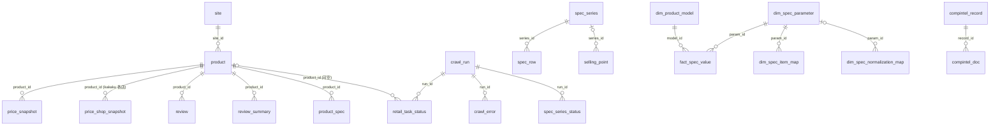

# 数据库结构说明（唯一主库 `data/overseas.db`）

更新：2026-10-12。schema_version = 9，35 张表。逐列明细（类型、约束、索引、行数）见同目录
`数据库表结构明细.md`，由 `scripts/gen_db_doc.py` 从库里自动生成，改表后重跑即可。

## 1. 总览

- **引擎**：SQLite 单文件。路径默认 `<项目>/data/overseas.db`，所有程序都认环境变量 `OVERSEAS_DB_PATH`。
  `OVERSEAS_DB_URL` 预留给外部数据库，当前未启用。
- **建表与迁移**：核心 27 张表的建表语句在 `overseas/schema.sql`，迁移在 `overseas/db.py`
  （`Database.init_schema()`，幂等）。任何程序第一次打开库都会自动补表、补列、升版本。
  **不要手工 ALTER**，要改结构就改这两个文件。
- **例外（8 张辅助表，DDL 不在 schema.sql/db.py，但列定义见 `数据库表结构明细.md`）**：
  - `dim_spec_parameter` / `dim_spec_normalization_map` / `fact_benchmark_comparison`：
    DDL 在 `01_项目代码/规格表结构构建.sql`（含初始化数据），由对阵分析线建表，不随主程序自动迁移。
  - `dim_product_model` / `dim_spec_item_map` / `fact_spec_value`：
    DDL 原建在旧库 `海外/overseas_v4_20260929.db`，由 `scripts/import_benchmark_tables.py`
    整表导入主库时带过来；后续由 `maintain_benchmark_tables.py`、`overseas/backfill.py` 维护。
    本仓库无独立 `.sql` DDL，需重建时按 `数据库表结构明细.md` 逐列建表。
  - `media_review` / `media_bestlist`：由 `scripts/crawl_media_reviews.py`、
    `insert_media_reviews.py` 以 `INSERT OR REPLACE` 写入（建表 `CREATE TABLE IF NOT EXISTS`
    内嵌在抓取流程中）；本主库的表结构是从旧库并入、随抓取脚本沿用，无独立 `.sql`。
  这 8 张表的**含义、列、行数在本文件 §3.4/§3.5 与 `数据库表结构明细.md` 逐列有完整说明**，
  与实库一致；只是建表 DDL 的物理位置不在 `schema.sql`，迁移或重建时按上表找来源。
- **一份库，多条业务线**：

| 表族 | 表 | 写入方 | 主要读取方 |
|---|---|---|---|
| 零售线（价格+评价） | site, product, price_snapshot, review, review_summary, product_spec, retail_task_status | `scripts/crawl_ca_retail.py` 等零售入口（经 `overseas/db.py`） | 导出脚本、`overseas/api/service.py`、对阵分析、报告 |
| 日本 kakaku 线 | price_shop_snapshot, kakaku_task_status, kakaku_thread_state（另用 product/price_snapshot/review） | `scripts/crawl_kakaku_*.py` | 日本线导出、API |
| 官网 SPEC 线 | spec_series, spec_row, spec_series_status, spec_entry_audit, spec_untranslated | `python -m overseas.cli spec-crawl` | `spec-export`、对阵分析维护、报告 |
| 卖点线 | selling_point, selling_point_status | `sp-*` 命令（**目前 0 行**） | `sp-export` |
| 媒体评测线 | media_review, media_bestlist | `scripts/crawl_media_reviews.py`、`insert_media_reviews.py` | TCP 报告 |
| 对阵分析线 | dim_product_model, dim_spec_parameter, dim_spec_item_map, dim_spec_normalization_map, fact_spec_value, fact_benchmark_comparison | `maintain_benchmark_tables.py`、`overseas/benchmark_server.py`（回溯补全写 fact_spec_value） | 对阵分析服务（`启动竞品对阵分析.bat`，端口 8090）、`overseas/backfill.py` |
| 竞品认证预警线 | compintel_record, compintel_doc, compintel_alert, compintel_crawl_state, compintel_skip | `python -m overseas.cli compintel-*`（`overseas/compintel/`） | `compintel-alert/stats/search`、看板 `compintel-web`（端口 8088） |
| 运行审计 | crawl_run, crawl_error, raw_page, ranking_snapshot, schema_version | `overseas/db.py` | 运维排查 |

### 1.5 设计意图（为什么是这个结构）

- **单库多线，不分库**：项目历史上曾按区域/国家各起一个库（na/sa/eu/japan/mx/v4…），最多散成 40 多个文件，
  导致跨线比对、合并、去重都极难。当前设计强制**唯一主库**（`data/overseas.db`），所有业务线写同一份库，
  跨线关联（如零售价 ↔ 官网 SPEC ↔ 对阵分析）直接 JOIN，无需 ETL 搬运。外部库要并入只用 `consolidate_db.py`。
- **时序只增不改**：`price_snapshot` / `review_summary` / `price_shop_snapshot` / `spec_row`（按 ISO 周）
  全部只 INSERT、不 UPDATE。天然形成价格曲线与口碑趋势；单表覆盖更新会丢历史。这是"周度报表"的数据基础。
- **靠值关联，不靠外键**：库里几乎没有外键约束（仅 compintel_alert.run_id 等少数）。跨表关联靠**值**：
  `product.model` ↔ `spec_series.models`、`dim_product_model(brand,model_code)` ↔ `product.model`。
  原因：型号写法跨国不一致（大小写/连字符/国家后缀），强外键会大量断裂；改为值关联 + 归一化函数更灵活。
  代价：写 SQL 时要自己保证 JOIN 键归一（见 §4.2），不能依赖数据库约束兜底。
- **业务线分族，表前缀即归属**：`spec_*`=官网 SPEC 线，`dim_*`/`fact_*`=对阵分析加工表，
  `compintel_*`=认证预警线，`kakaku_*`=日本线，`media_*`=媒体评测，`crawl_*`/`*_task_status`=运行审计。
  前缀一眼看出写入方与读取方（见上表），避免"这表谁在写"的混乱。
- **加工表与原始表分离**：`dim_*`/`fact_*` 是从 `spec_row`/`product_spec` **加工**出来的维度/事实表，
  不是原始数据；主库更新后**不会自动刷新**，要手动跑 `maintain_benchmark_tables.py`。原始表（product/price_snapshot/review/spec_row）才是真源。
- **国家不设字段，靠站点 code 推**：库里没有"国家"列。国家由 `site.code` 后缀（`_ca/_mx/_de…`）或
  适配器 `country` 属性推出（`export_by_country.py` 据此导出）。这样同一套表能装任意国家，不用每加一国改表结构。
- **schema 版本化 + 幂等迁移**：`schema_version` 表记录版本，`db.py::init_schema()` 每次打开库自动补表/补列/升版本，
  幂等不破坏数据。改结构改 `schema.sql`+`db.py`，不手工 ALTER。

## 2. 表间关系



**没有外键、靠值关联的地方**（最容易写错 SQL）：
- 零售线 ↔ SPEC 线：`product.model` ↔ `spec_series.models`（JSON 数组）/ `spec_row.values_json` 的键。
  型号写法常不一致（大小写、`-`、尺寸前缀、国家后缀），要先归一化（去空格/连字符、转大写）再比。
- 对阵分析 ↔ 原始数据：`dim_product_model(brand, model_code)` ↔ `product.model` / spec 机型名；
  `fact_spec_value.source_table + source_term` 记录了取值来自 `spec_row.item_ja` 还是 `product_spec.key`。
- 国家：库里**没有国家字段**。国家由站点 code 推出（`site.code` 后缀 `_ca/_mx/_de…`，或适配器的 `country` 属性，
  见 `scripts/export_by_country.py`）。区域与站点的注册关系在 `overseas/regions_auto.py`。
- 品牌：`product.brand` 是站点原文，`spec_series.brand` 是品牌站 code（如 `hisense_jp`）。两者不是同一套取值。
- compintel 与电视数据完全解耦，只靠 `brand`/`model` 文本可以松散对照。

## 3. 各表含义（按业务线）

### 3.1 零售线
| 表 | 一行是什么 | 关键字段 | 行数 |
|---|---|---|---|
| site | 一个站点 | `code` 唯一（如 `amazon_ca`、`mediamarkt_de`）；`protection` L1/L2/L3 反爬等级 | 260（其中 102 个没有商品） |
| product | 某站上的一个商品 | `(site_id, sku)` 唯一；`model` 厂商型号；`brand`/`title`/`size`/`category` 为站点原文；`first_seen`/`last_seen` | 14,643 |
| price_snapshot | 一次抓取看到的价格（只增不改，时序） | `price` 成交价、`list_price` 划线价、`currency`、`in_stock` 1/0/NULL、`raw_text` 价格来源原文、`captured_at` | 15,894 |
| review | 一条用户评价 | `(product_id, review_key)` 唯一（站内评价 ID，增量去重）；`rating`、`title`、`body`、`author`、`review_date`、`verified`、`helpful_count`、`review_url`、`image_urls`/`video_urls`（JSON） | 95,207 |
| review_summary | 一次抓取看到的评分汇总（时序） | `avg_rating`、`total_count`、`star1..star5` | 3,965 |
| product_spec | 零售详情页上的一条规格键值 | `(product_id, key)` 唯一 | 138,069 |
| retail_task_status | 一次运行里「某站 × 某型号 × 价格/评价」的结果 | `status`: ok / no_item / no_price / no_reviews / summary_only / ok_summary_only / blocked / failed；`message` 写原因 | 10,610 |

### 3.2 日本 kakaku 线
| 表 | 含义 |
|---|---|
| price_shop_snapshot | kakaku 比价页上每家店的价格（8 家店），`is_lowest=1` 为当次最安店 |
| kakaku_task_status | kakaku 型号级任务状态（发售年、尺寸、行数、新增数） |
| kakaku_thread_state | kakaku 口碑帖子的增量游标（`last_post_key`） |

### 3.3 官网 SPEC 线
| 表 | 含义 |
|---|---|
| spec_series | 品牌官网一个系列。`(brand, series)` 唯一，`brand` 是品牌站 code（`hisense_jp`、`lg_us`…），`models` 为该系列机型列表 JSON（即 `spec_row.values_json` 的列顺序） |
| spec_row | 系列规格表的一行。`item_ja` 项目原文（**名字叫 ja，但欧美站存的是英/西/德等原文**），`item_zh` 中文翻译（大多为空），`values_json` = {机型: 值}，`captured_week` ISO 周（每周一份快照） |
| spec_series_status | 每次 spec 抓取中每个系列的结果与 URL 选择过程 |
| spec_entry_audit | 入口页审计：期望 / 实际发现的系列数与机型数 |
| spec_untranslated | 未翻译的规格项目词表（翻译待办） |

### 3.4 卖点 / 媒体 / 运行审计
- `selling_point`、`selling_point_status`：卖点线，表已建，**0 行**。
- `media_review`：评测文章（JSON-LD 解析的评分、优缺点、评测机型），148 行；`media_bestlist` 0 行。
- `crawl_run`（2,134）、`crawl_error`（5,820）：每次运行与错误日志。`raw_page`、`ranking_snapshot` 0 行。
- `schema_version`：版本历史，当前 9。

### 3.5 对阵分析线（下游应用一：竞品对阵分析服务）
从零售线和 SPEC 线**加工**出来的维度/事实表，供 `overseas/benchmark_server.py`（`启动竞品对阵分析.bat`，
http://127.0.0.1:8090）出雷达图、规格对比、AI 对阵结论。维护脚本：`maintain_benchmark_tables.py`。

| 表 | 含义 | 行数 |
|---|---|---|
| dim_spec_parameter | 18 个标准对比参数（峰值亮度、刷新率、HDR、分区数…），含单位、是否越大越好、雷达维度 | 18 |
| dim_product_model | 归一化机型：`(brand, model_code)` 唯一，`size_inch`、`series`、`region`、`price_tier`、`our_brand`（1=海信） | 6,493 |
| dim_spec_item_map | 源术语 → 标准参数的映射规则：`source_table`（spec_row/product_spec）+`source_term`，带提取正则，`status` AUTO/CONFIRMED/REJECTED | 1,974 |
| dim_spec_normalization_map | 跨品牌同义术语分组（如「144Hz 高刷」族） | 9 |
| fact_spec_value | 机型 × 参数的取值：`value_text` 原文、`value_numeric` 数值、`confidence`，`(model_id, param_id, source_table)` 唯一 | 52,636 |
| fact_benchmark_comparison | 一次对阵结论（我方机型 vs 竞品列表，优势/劣势/机会点 JSON） | 4 |

### 3.6 竞品认证预警线（下游应用二：compintel）
抓 FCC / EPREL / ENERGY STAR / ANATEL / IC-ISED / TÜV / UL 等认证与能效注册库，发现竞品新机上市前信号。
代码 `overseas/compintel/`，命令 `python -m overseas.cli compintel-*`，看板 `compintel-web`（端口 8088），
定时任务 `scripts/compintel_daily.ps1` / `compintel_weekly.ps1`。

| 表 | 含义 | 行数 |
|---|---|---|
| compintel_record | 一条认证/注册记录的一次快照。`source` ∈ fcc/eprel/energystar/ul/tuv/ic_ised/anatel；`(source, source_id, captured_at)` 唯一 | 851 |
| compintel_alert | 预警信号：`signal_type` new_fcc_id / eprel_new_reg / new_cert / launch_warning / energy_class_jump / eprel_delisted / supplier_change …；`level` info/watch/alert/critical | 980 |
| compintel_crawl_state | 增量断点（每个 FCC 授权码 / EPREL 扫描区间一行） | 85 |
| compintel_doc / compintel_skip | 认证附件清单 / 跳过名单 | 0 / 0 |

## 4. 使用误区（每条都是库里实测到的情况）

### 4.1 价格
1. **币种不能默认按站点推断**。`currency` 有 1,256 行为空；同一站会出现多种币种
   （amazon_us 出现 USD/CAD/MXN，amazon_uk 出现 GBP/USD，carsa_pe 出现 PEN/USD）。
   原因：Amazon 跟随代理出口与邮编显示货币，部分站以美元标价。统计前先 `WHERE currency = '<本币>'`，空币种不要参与。
2. **价格有明显坏值**。COP 最低 1、GBP 最低 1、BOB 最低 1、PEN 最低 4.5，`''` 币种最高 6,600,000。
   这些多是配件、分期每期金额、欧式小数解析错误。用价前按币种设电视价下限（`overseas/price_sanity.py` 的口径），
   或只用 `product.model` 非空、`category` 为电视的行。
3. **`list_price` 不一定大于 `price`**：293 行划线价低于成交价（站点把会员价/旧价放反）。算折扣率前先过滤。
4. **`in_stock` 三值**：1 有货、0 无货、NULL 页面没给（4,736 行）。NULL ≠ 无货。
5. **价格是时序表**。同一商品多次抓取有多行；「当前价」要按 `product_id` 取 `MAX(captured_at)` 那行，不要直接 AVG。
6. **价格为 NULL 的站**：spec 标了 `_price_suspect` 的站（max_gt、tecnofacil_gt、mediaexpert_pl）全量时故意不写价，缺价不是 bug。

### 4.2 商品、型号、品牌
1. **`product.model` 有 2,625 行为空**，`size` 有 4,250 行为空。跨站比价、对阵分析都只能用有型号的行；
   空型号可从 `title` 正则补（`scripts/clean_rebuild_delivery.py` 有现成规则）。
2. **品牌不统一**：同一品牌有 `Samsung`/`SAMSUNG`/`samsung_co`/`samsung_cl`，`LG`/`Lg`/`LG（加拿大）`，
   `TCL`/`Tcl`/`TCL（日本）`，还有 2,030 行品牌为空。按品牌聚合前先归一：去括号后缀、去 `_<cc>`、转统一大小写。
   `dim_product_model.brand` 是已归一化的版本，可作对照。
3. **同一机型各国型号码不同**：美国 `UN55U8000HFXZC`、欧洲 `UE55U8000…/GQ55…`、拉美 `UN55…GXPE`。
   `product.model` 存的是站点上的码，不是全球统一码。跨国比较要靠 `dim_product_model.model_aliases` 或系列名。
4. **型号大小写/连字符重复**：37 组型号只差大小写、空格或 `-`。比对前做 `UPPER(REPLACE(REPLACE(model,'-',''),' ',''))`。
5. **`category` 混乱**：`TV`/`tv`/`television`/`QLED TVs`/`LED & LCD TVs`、空值，还有 `Remote Controls` 这类配件。
   筛电视用「category 含 tv/televis 或 model 非空」，并排除配件词。
6. **site 表 260 行但只有 158 个站有数据**：102 个站点只注册未抓到（被拦、未启用、仅 SPEC）。统计「覆盖站数」用有商品的站。
7. **`product` 的唯一键是 `(site_id, sku)` 不是型号**：同站同型号可能有多个 sku（不同颜色/捆绑/第三方卖家），按型号取价要去重。

### 4.3 评价
1. **评价会「串尺寸」**：BazaarVoice、MediaMarkt 等按商品族聚合评价，55 寸商品下面可能挂着 65 寸的评价。
   来源商品号写在 `review_url` 锚点里（`#bv-src-product=<id>`，7,261 条；`#mms-src-product=<id>`）。
   做单尺寸分析要剔除带锚点的行；做系列分析则可保留。
2. **`review_date` 格式不统一**：ISO（`2025-11-14T06:43:25.066Z`）、带时区（`2026-07-29T10:31:01.000+00:00`）、
   Amazon 原文（`Reviewed in Canada on September 13, 2026`）、只有月份（`December 2025`）都有。
   按日期统计前要先解析；`captured_at` 是抓取时间，不是评价时间。
3. **`rating` 有 752 条为空、存在 0 分**：0 多为站点没给星级（只有文字），不是真实 0 星。均分计算排除 NULL 和 0。
4. **`review_summary` 星级分布大多为空**：3,965 行里 3,138 行 `star5` 为空（站点只给均分和总数）。
   `total_count` 是站点公布的总评价数，通常**大于**库里抓到的明细条数（受抓取上限 50/100 条限制）。
5. **评价是增量的**：`review_key` 去重，重复抓不会重复插；但不同站的 `review_key` 规则不同，跨站不能用它去重。

### 4.4 SPEC
1. **`spec_row.item_ja` 不只是日文**：欧美拉美品牌站存的是英/西/德/法原文。`item_zh` 179,249 行里 145,831 行为空（只有日本线和部分站翻译过）。
2. **每周一份快照**：`captured_week` 有 W37~W40 四周，605 个系列有多周数据。取最新规格要按系列取 `MAX(captured_week)`，
   直接 GROUP BY 会把多周合并重复计数。
3. **`values_json` 的键是机型名**，顺序与 `spec_series.models` 一致；有的站键是尺寸（`55"`）或带括号说明，不一定等于零售 `product.model`。
4. **SPEC 里混有非电视**：如 `samsung_us` 抓到了 `Music Studio 5 Speaker`（音箱）。用 spec 前按 `series`/机型名过滤。
5. **`spec_series.brand` 带国家后缀**（`lg_us`、`samsung_pe`），同一品牌不同国家是不同系列行，不要当作重复删除。

### 4.5 对阵分析表与 compintel 表
1. **对阵分析表是加工产物，不是原始数据**：`fact_spec_value` 由映射规则从 `spec_row`/`product_spec` 抽出，
   原始库更新后**不会自动刷新**，要重跑 `maintain_benchmark_tables.py`。它们的 `model_id` 只在 `dim_product_model` 内有效，
   与 `product.id` 无关。
2. **`dim_product_model` 有脏行**：5,133 行 `region` 为空；存在 `AMAZON 2DA`、`GENERICO 8CM`、品牌空、型号 `40` 这类从标题误切出的机型。
   对阵时只选 `our_brand=1` 的海信机型和有 `size_inch`、有足够 `fact_spec_value` 的竞品。
3. **`dim_spec_item_map.status`**：只有 `CONFIRMED` 是人工确认过的映射，`AUTO` 可能错配（如把「HDMI 数量」配成「HDMI 版本」）。
4. **compintel 的 `run_id` 为空**：这批数据从 `海外/data/overseas.db` 并入时，对应的运行日志没有迁过来，`run_id` 统一置 NULL。
5. **compintel 的 `source` 有 CHECK 约束**：只能是 fcc/eprel/energystar/ul/tuv/ic_ised/anatel，新增数据源要先改 `schema.sql`
   并在 `db.py` 加迁移（SQLite 不能 ALTER CHECK，只能重建表，参考 `_migrate_compintel_source_check`）。
6. **compintel 记录是快照时序**：同一 `source_id` 每次抓取一行，统计「多少个认证」要 `COUNT(DISTINCT source_id)`。

### 4.6 时间与运行日志
1. **`captured_at` 有四种格式**：`2026-09-24T09:37:35+00:00`（25 位）、带微秒的 32 位、`2026-09-30 01:11:11`（空格分隔，无时区）、
   20 位 `…Z`。大部分是 UTC。按日期比较请先 `substr(captured_at,1,10)`，不要直接字符串比较完整时间。
2. **`retail_task_status` 的 `no_item` 不等于「站上没卖」**：6,232 行 no_item 中，相当一部分是型号清单用了别国型号码、
   或品牌候选池太小。真正被拦记为 `blocked`/`failed`。看覆盖率时三者分开看。
3. **`retail_task_status` 有 58 条外键悬空**（引用已清理的商品/运行记录），历史遗留，不影响业务表；需要时
   `DELETE FROM retail_task_status WHERE product_id NOT IN (SELECT id FROM product)` 清理（先备份）。

### 4.7 操作误区
1. **不要另起数据库**：历史上就是因为各线各写各的库（na/sa/eu/japan/mx/v4…）才散成 40 多个文件。
   新脚本一律用 `overseas.config.DB_PATH` / `OVERSEAS_DB_PATH`。真有外部库要并入，用 `scripts/consolidate_db.py`（先 `--dry-run`）。
2. **改库前备份**：`copy data\overseas.db data\overseas_before_<事由>_<日期>.bak`。合并/导入脚本都会自动备份。
3. **SQLite 并发写**：同时跑多个抓取进程会互相等锁（`database is locked`）。长任务尽量串行，或分站点错开；
   不要在抓取时用 DB 浏览器打开写事务。
4. **`data/` 不进 git**：主库靠备份，不靠版本库。

## 5. 常用查询

```sql
-- 某国某型号各站最新价（以加拿大 55U7SG 为例）
SELECT s.code, p.model, ps.price, ps.currency, ps.captured_at
FROM product p JOIN site s ON s.id = p.site_id
JOIN price_snapshot ps ON ps.product_id = p.id
WHERE s.code LIKE '%\_ca' ESCAPE '\' AND UPPER(REPLACE(p.model,'-','')) = '55U7SG'
  AND ps.captured_at = (SELECT MAX(captured_at) FROM price_snapshot WHERE product_id = p.id)
  AND ps.price > 0;

-- 某商品评价（剔除串尺寸）
SELECT rating, title, body, review_date FROM review
WHERE product_id = ? AND review_url NOT LIKE '%#bv-src-product=%' AND review_url NOT LIKE '%#mms-src-product=%';

-- 某系列最新一周的规格
SELECT r.item_ja, r.item_zh, r.values_json FROM spec_row r
WHERE r.series_id = ? AND r.captured_week = (SELECT MAX(captured_week) FROM spec_row WHERE series_id = r.series_id)
ORDER BY r.row_order;

-- 近 30 天竞品认证预警
SELECT detected_at, signal_type, brand, model, message FROM compintel_alert
WHERE detected_at >= date('now','-30 day') ORDER BY detected_at DESC;
```
